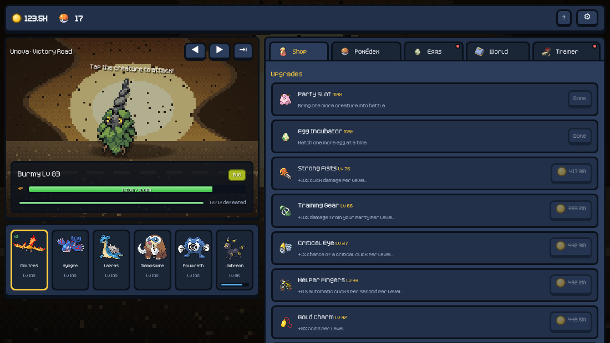

# Tall Grass Clicker

[](https://github.com/ducampcarlos/tall-grass-clicker/actions/workflows/ci.yml)

[](LICENSE)

**An unofficial, fan-made creature-catching clicker for the browser.** Tap to battle, catch and evolve all **649 creatures of generations 1 to 5** with their animated sprites, hunt shinies, hatch eggs, climb five regions and an endless Tower, then retire and start again stronger.

<p align="center"></p>

> **Play it:** <https://ducampcarlos.github.io/tall-grass-clicker/>. It is free, has no ads, no accounts and no donations, runs offline once loaded and can be installed like an app.

> **Not affiliated with Nintendo, Creatures Inc., GAME FREAK inc. or The Pokémon Company.** Pokémon and its characters are their trademarks and artwork. This is a non-commercial fan project, and the pictures and icons are not covered by the MIT license: see [Legal](#legal).

## How it plays

- **Tap** the creature to hurt it. Your **party of up to six** fights too, on its own. Defeating creatures pays coins and experience, and gives you a chance to **catch** them.
- **Spend coins** in the Shop on damage, critical hits, automatic clicks, better catch odds, rarer encounters, a shiny charm, party slots and incubators; buy Great, Ultra and Master Balls (Master Balls are gifts from champions, kept for legendaries).
- **Walk the world.** Five regions (Kanto, Johto, Hoenn, Sinnoh, Unova) of 12 places each: beat 12 creatures to open the next one. The 6th place has a gym leader and the 12th a champion, who escape if you take too long. Past the fifth champion the **Tower** never ends.
- **Places look like places.** Thirteen pixel-art backgrounds (meadow, forest, cave, lake, mountains, gym, swamp, desert, haunted tower, power plant, victory road, the champions' hall and the Tower), tinted by the light of each region, on the battle and behind the whole page. They are original, drawn by `scripts/gen-scenes.py`.
- **Types matter.** The full 18-type chart is in: your best attacker against the creature in front is the one that counts, and the numbers on your party show how well each fares.
- **Collect.** Duplicates give candy (10 candy = a level), creatures level up to 100 and **evolve** at their real levels. **Eggs** (basic, rare, epic, legendary) hatch as you click and win. **Shinies** are 1 in 4096 (a charm brings that toward 1 in 1100) and hit half again as hard. The Pokédex bonus makes everything stronger, and so do the 47 achievements.
- **Retire.** When you are stuck, start over keeping the Pokédex. You are paid **Marks** only for going further than ever before, and Marks buy permanent perks in a three-branch tree (Training, Fortune, Hunter). Each run goes faster.
- **Idle friendly.** Progress continues while the tab is closed (up to 8 h at half speed), and saves every few seconds.

In **English, Spanish and Portuguese**, starting in your browser's language. Your whole save can be exported to a file and imported back (validated field by field) from the settings.

## Run it

```sh
npm ci
npm run build      # bundles src/ into docs/game.js
npx serve docs     # or any static server; open the printed address
```

Needs Node 22 or newer. `npm run dev` rebuilds on change. The game is the `docs/` folder: plain static files, which is also what GitHub Pages serves (Settings → Pages → Deploy from a branch → `main` / `docs`).

| Command | What it does |
| --- | --- |
| `npm test` | unit tests (engine, saves, data, translations) |
| `npm run test:e2e` | drives the built game in a real Chromium (needs `npx playwright-core install chromium` or `CHROME_PATH`) |
| `npm run typecheck` | `tsc --noEmit` |
| `npm run balance` | a bot plays the game and prints the pace (informational) |
| `npm run dex` | regenerates `src/engine/dex.generated.ts` from the PokeAPI CSVs in `data/` |
| `npm run sprites` | downloads the sprites into `docs/assets/sprites/` |
| `python3 scripts/gen-scenes.py` | redraws the biome backgrounds into `docs/assets/scenes/` (needs Pillow and numpy) |
| `bash scripts/fetch-ui.sh` | downloads the item icons and gym badges of the interface |

## How it is built

- **A deterministic engine** in plain TypeScript (`src/engine/`): seeded random number generator kept in the save, commands that mutate one state and return events. No DOM, so a bot (`src/sim/`) can play thousands of hours to tune the numbers, and every test is exact.
- **A small DOM interface** (`src/web/`), a fixed-step game loop, esbuild to a single `docs/game.js`. No framework, no runtime dependencies.
- **Saves** go to `localStorage`, mirrored to `sessionStorage` and memory so a blocked or cleared one does not lose the session; loading validates every field and refuses anything impossible.
- **Offline**: a service worker precaches the game and caches sprites as you see them.
- **Translations**: the English text is the key (`t("Text")`); `tests/i18n.test.ts` fails if any text of the game is missing from `src/i18n/es.ts` or `pt.ts`.

## Legal

The code is [MIT](LICENSE). The creatures' names, data and pictures are **not** mine and **not** MIT: they belong to Nintendo, Creatures Inc. and GAME FREAK inc., and are included only so this free, non-commercial fan game works offline. See [CREDITS.md](CREDITS.md) and [docs/assets/sprites/NOTICE.md](docs/assets/sprites/NOTICE.md). The project earns nothing and takes no donations. **If you are a rights holder and want something removed, open an issue**: the game can load the same pictures remotely from [PokeAPI/sprites](https://github.com/PokeAPI/sprites), so the folder can go without breaking it. If you reuse this code, bring your own art.
